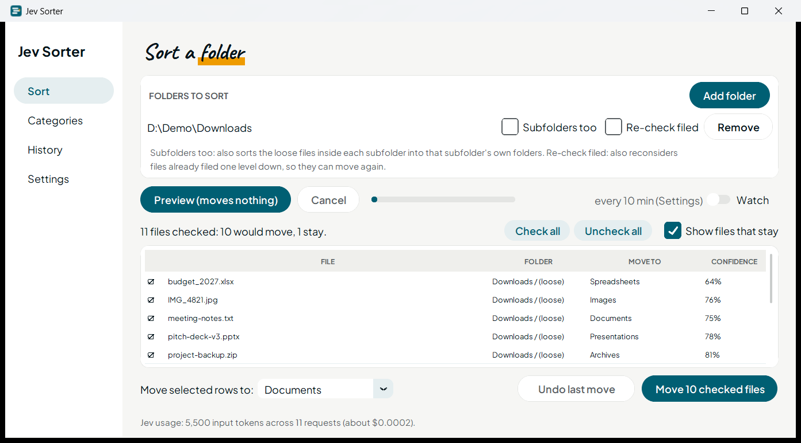
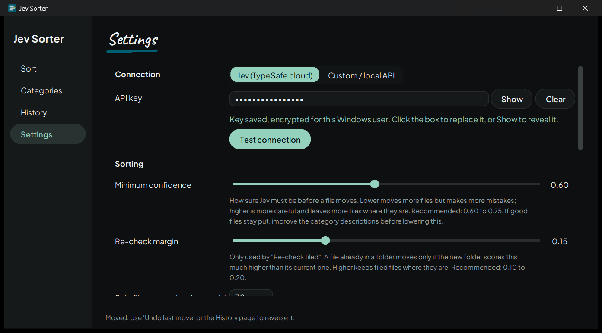
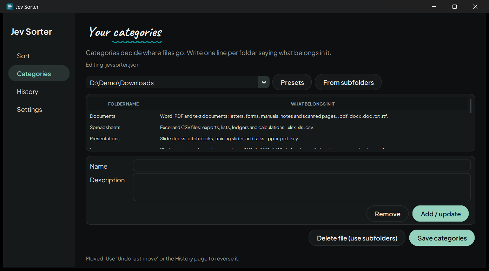
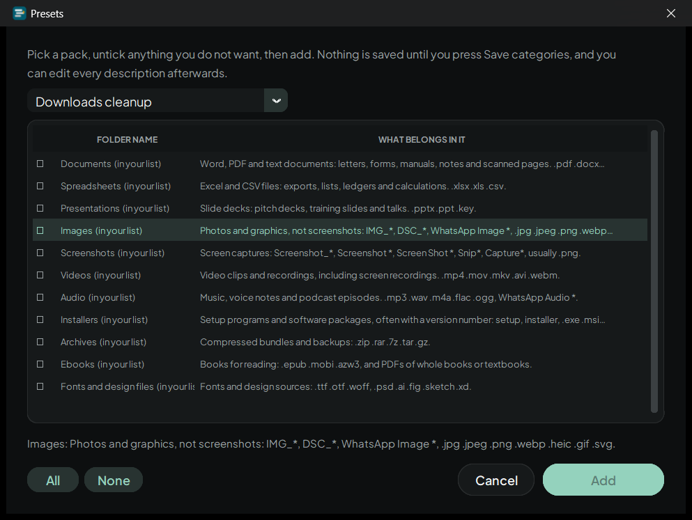
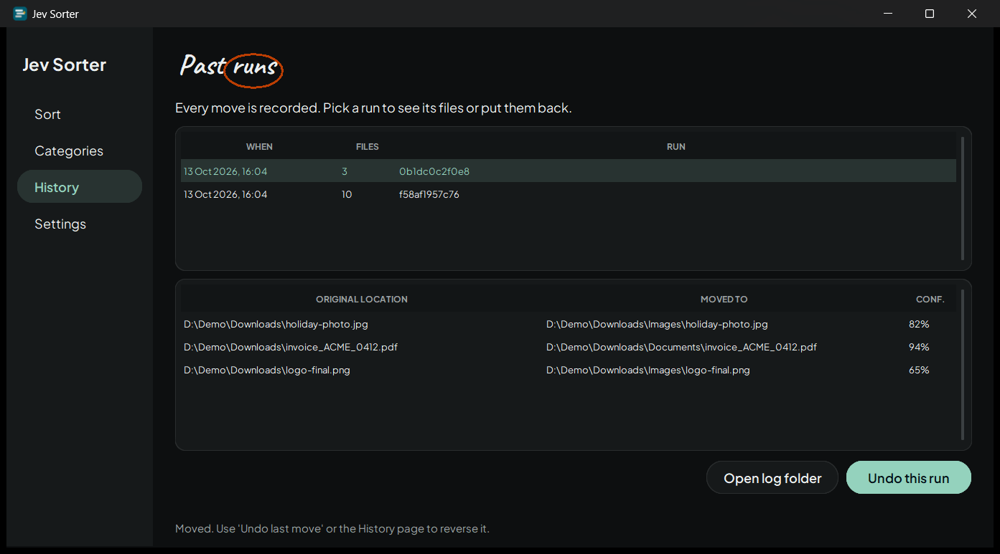

# Jev Sorter

Tidy a messy folder in a minute. Jev Sorter reads each filename, asks [Jev](https://typesafe.ai) which of your folders it belongs in, shows you the plan, and moves only what you approve. Every move is logged and can be undone.

<picture>
  <source media="(prefers-color-scheme: dark)" srcset="docs/screenshots/sort-dark.png">
  
</picture>

- **Preview first.** Nothing moves until you press the button. Untick files or pick a different folder for any of them.
- **Undo any run.** History keeps every move with its original location.
- **Safe by default.** It never overwrites, skips downloads still in progress, and leaves a file alone when Jev isn't sure.
- **Your categories, your words.** A one-line description per folder is all Jev needs. Presets get you started.
- **Runs quietly.** Watch a folder from the tray (or Dock) and get told when files are ready.
- **Cloud or local.** Use the Jev API with your key, or point it at your own server.

## Install

Download the file for your system from the [latest release](../../releases/latest).

| System | File | How |
|---|---|---|
| Windows 10 or 11 (64-bit) | `JevSorter-Setup-<version>.exe` | Run it. It installs for your user only, so there's no admin prompt. |
| macOS (Apple Silicon) | `JevSorter-<version>-macos-arm64.dmg` | Open it and drag Jev Sorter to Applications. |
| Linux (x86-64) | `JevSorter-<version>-linux-x86_64.tar.gz` | Unpack it and run `./install.sh`. It installs to `~/.local`, no root needed. |

`SHA256SUMS.txt` on the release page has a checksum for each file.

**The builds aren't code-signed yet**, so your system warns once:

- **Windows:** SmartScreen says "Windows protected your PC". Click **More info**, then **Run anyway**.
- **macOS:** if the app is blocked, open **System Settings, Privacy & Security** and choose **Open Anyway**. Or run `xattr -dr com.apple.quarantine /Applications/JevSorter.app`.
- **Linux:** no prompt.

Windows is the most tested (on Windows 11). The Linux build is tested in a container (self-tests, the full GUI flow under a virtual display, and the install script). The macOS build comes from CI and hasn't been run on a real Mac yet, so please [open an issue](../../issues) if something is off.

To remove it: Windows has it under Settings, Apps. On macOS drag the app to the Bin. On Linux run `~/.local/opt/JevSorter/install.sh --uninstall`. Your settings and history stay in the data folder (see [Where things are stored](#where-things-are-stored)) until you delete it.

## First run

**1. Connect.** Open **Settings** and paste your Jev API key. Press **Test connection** to check it.



Using your own server instead? Switch to **Custom / local API** and enter its URL. See [Custom or local API](#custom-or-local-api).

**2. Describe your folders.** On **Categories**, pick a folder and add one category per subfolder you want files sorted into. Each needs a short description of what belongs there. **Presets** gives you ready-made packs to start from.



**3. Sort.** On **Sort**, add the folder, press **Preview**, review the table, then **Move checked files**.

## Using the app

### Sort

Press **Preview** and Jev Sorter asks about each loose file in the folder. The table shows where each one would go and how sure Jev is. Click a row's box to untick it. Select rows and use **Move selected rows to** to send them somewhere else. **Show files that stay** reveals the ones Jev left alone, which is the quickest way to see why.

Two options per folder:

- **Subfolders too** also sorts the loose files inside each subfolder into that subfolder's own folders.
- **Re-check filed** also reconsiders files already filed one level down, so they can move again. A filed file only moves if the new folder beats its current one by the margin in Settings.

You can only use one of the two on a folder, because they would judge the same file twice.

### Categories

Categories are saved as `.jevsorter.json` in the folder you're sorting. Without that file, the folder's existing subfolders are used, each described by the filenames already inside it. Descriptions matter far more than names: a bare folder name scored 0.47 for one real file, and a single clear line scored 0.98.



**Presets** and **From subfolders** both open a preview first. Pick what you want, and nothing is written until you press **Save categories**. Other keys in the file, such as `_note`, are kept.

### History



Every run is listed with its files and where they came from. **Undo this run** puts them back, but only where the original spot is still free.

### Watch and the tray

Turn on **Watch** on the Sort page and Jev Sorter rescans every few minutes. By default it only shows you a preview and tells you when files are ready. It moves files on its own only if you enable **Move files without asking** in Settings.

With **Keep running in the system tray** on, the close button hides the window and Watch keeps going. The tray icon has Open, Watch folders and Quit. A second launch (a shortcut, or the folder right-click item on Windows) opens the running app instead of starting another.

- **Windows:** the tray is on by default.
- **macOS:** there's no tray icon. Closing the window keeps the app running in the Dock. Click the Dock icon to reopen it, or press Cmd+Q to quit.
- **Linux:** the tray is off by default, because GNOME has no tray without the AppIndicator extension. Turn it on in Settings if your desktop has one.

**Start when I sign in** launches it hidden at login.

### Settings you may want to change

| Setting | Default | What it does | Recommended |
|---|---|---|---|
| Minimum confidence | 0.60 | How sure Jev must be before a file moves. Lower moves more files with more mistakes. | 0.60 to 0.75 |
| Re-check margin | 0.15 | Only for Re-check filed. How much better a new folder must score than the current one. | 0.10 to 0.20 |
| Skip files newer than | 30 s | Leaves recently changed files alone, so a download or save in progress is never moved. | 30 to 120 |
| Subfolder depth | 3 | How deep Subfolders too goes. | 2 or 3 |
| Watch interval | 10 min | How often Watch rescans. | 5 to 30 |
| Ask before | all on | Which actions show a confirmation. Each question also has a "Don't ask me again" box. | leave on |

If good files stay put, improve the category descriptions before lowering the confidence.

## How it decides

For each file, Jev Sorter sends one question to Jev with the file's name, extension, size and modified date. The options are your categories plus a "stay" option. Jev returns a probability for every option and a confidence score.

A file moves only when the top choice is a real folder and the confidence is at or above your minimum. Everything else stays exactly where it is. There's no "review" folder, because that would just be a second pile to sort.

Jev reads filenames, not contents. It doesn't open your PDFs or documents.

## Custom or local API

Switch **Settings, Connection** to **Custom / local API** to use your own server. It has to speak the same request format as the Jev API. The key is optional, and the `Authorization` header is only sent when you set one.

Request (`POST` to your URL, JSON):

```json
{
  "state": {"name": "invoice_march.pdf", "ext": ".pdf", "size_bytes": 48211,
            "modified": "2026-03-02T10:14:09", "current_folder": "Invoices"},
  "model": "jev-latest",
  "questions": {"folder": {
    "type": "choice",
    "instructions": "Which of the listed folders does this file belong in? ...",
    "criteria": {"Invoices": "Issued invoices ...", "Photos": "Pictures ...", "__stay__": "Leave it where it is."}
  }}
}
```

`current_folder` is only present when **Re-check filed** is on. Response:

```json
{
  "answers": {"folder": {"choice": "Invoices", "confidence": 0.94,
                         "probabilities": {"Invoices": 0.94, "Photos": 0.03, "__stay__": 0.03}}},
  "usage": {"input_tokens": 480, "output_tokens": 12}
}
```

Requests time out after 60 seconds, and a request is tried up to three times if the server answers HTTP 429 or 529, or the network drops. **Test connection** sends one fake file so you can check your server before a real run. `tests/stub_server.py` is a small working example of the server side.

## Privacy

- Only the filename, extension, size and modified date of each file are sent, plus your category names and descriptions. File contents are never read or sent.
- Requests go to `api.typesafe.ai`, or to the URL you set. Nothing else is contacted.
- Your API key is kept in the system's vault: Windows DPAPI, the macOS Keychain, or the Linux Secret Service. If a system has no vault, the key goes in `settings.json`, readable only by your user. The key is never printed or logged.

## Safety

- Nothing moves without you pressing **Move checked files**, and every file is re-checked just before it moves.
- It never overwrites. A name clash becomes `name (1).ext`, then `name (2).ext`.
- Skipped on purpose: downloads in progress (`.crdownload`, `.part`, `.partial`, `.tmp`, `.download`, `.opdownload`, `.aria2`), Office lock files (`~$*`), `desktop.ini`, `Thumbs.db`, `.DS_Store`, shortcuts (`.lnk`, `.url`), and anything changed in the last 30 seconds. That's a code rule, never a question put to the model.
- A folder with more than 255 categories is refused rather than trimmed, because trimming would hide why files stayed put.
- Files in use are skipped and reported, not forced.
- Every move is logged, so undo works even after you close the app.
- Recursion never enters `node_modules`, `.git`, `.gradle`, `.kotlin`, `venv`, `.venv`, `__pycache__`, `site-packages`, `.next`, `.terraform`, `.tox`, `$RECYCLE.BIN`, `System Volume Information`, or any dot-folder.

## Cost

Jev costs $0.042 per million input tokens, and output is free. One request goes out per file, eight at a time. A real 208-file run took 27 seconds and cost about a cent. The Sort page shows the token count and an estimate after each preview.

## Where things are stored

| | Windows | macOS | Linux |
|---|---|---|---|
| Settings, move log, `gui.log` | `%LOCALAPPDATA%\jevsorter\` | `~/Library/Application Support/jevsorter/` | `~/.local/share/jevsorter/` |

Set `JEVSORTER_HOME` to use a different folder. `moves.jsonl` is the move log, and each line records the choice, confidence and top probabilities. `gui.log` collects errors from the window. To reset the app, close it and delete `settings.json`.

## Command line

The same engine runs without the window. It needs only Python 3.9 or later and no packages.

```bash
pipx install .                # from a checkout; adds the jevsorter command
export JEV_API_KEY="your-key" # setx JEV_API_KEY "your-key" on Windows

jevsorter propose ~/Downloads        # list filenames so you can write categories
jevsorter sort ~/Downloads           # dry run: prints decisions, moves nothing
jevsorter sort ~/Downloads --apply   # actually move
jevsorter undo last                  # reverse the most recent run
jevsorter selftest                   # built-in assertions, no network
```

`propose` and `sort` default to the current folder, and `sort` takes any number of folders.

| Flag | Default | What it does |
|---|---|---|
| `--apply` | off | Actually move files. Without it, nothing moves. |
| `--recursive` | off | Also sort each subfolder into its own subfolders. |
| `--max-depth` | 3 | How far `--recursive` descends. |
| `--resort` | off | Also reconsider files already filed in subfolders. |
| `--every N` | off | Rescan every N minutes instead of exiting. |
| `--min-age` | 30 | Skip files modified in the last N seconds. |
| `--min-confidence` | 0.6 | Below this, leave the file alone. |
| `--margin` | 0.15 | `--resort` only: how much a new folder must beat the current one. |

`--recursive` and `--resort` can't be combined. Run them as two passes. Always dry-run `--resort` first, since it's the one that can undo your filing. The window and the command line share the move log, so `undo` works on runs from either.

## Build from source

You need Python 3.9 or later with tkinter.

```bash
git clone https://github.com/umarshahzad0001/jev-sorter.git
cd jev-sorter
python -m pip install customtkinter pillow pystray keyring   # pystray: Windows and Linux; keyring: macOS and Linux
python jevsorter_gui.py                                      # run the window from the checkout
```

To build an installer, install `pyinstaller` as well and run the script for your system. PyInstaller can't cross-compile, so build on the system you're targeting.

| System | Command | Also needs | Output in `dist/` |
|---|---|---|---|
| Windows | `.\build.ps1` | [Inno Setup 6](https://jrsoftware.org/isinfo.php) (`winget install JRSoftware.InnoSetup`) | `JevSorter-Setup-<version>.exe` |
| macOS | `bash build.sh` | Xcode command line tools | `JevSorter-<version>-macos-<arch>.dmg` |
| Linux | `bash build.sh` | `python3-tk` | `JevSorter-<version>-linux-<arch>.tar.gz` |

Tests, all runnable on any system:

```bash
python jevsorter.py selftest      # engine: skip rules, thresholds, sort and undo, data folders
python jevsorter_settings.py      # settings and key storage
python jevsorter_tray.py          # single-instance handoff and login items
python jevsorter_presets.py       # preset packs
python tests/gui_smoke.py         # drives the real window against tests/stub_server.py
```

`tests/readme_shots.py` regenerates the screenshots above (Windows only).

| File | Role |
|---|---|
| `jevsorter.py` | Engine and command line |
| `jevsorter_gui.py` | The window |
| `jevsorter_theme.py` | Colors, fonts and widgets |
| `jevsorter_dialogs.py` | Confirmation and preset dialogs |
| `jevsorter_presets.py` | Starter category packs |
| `jevsorter_settings.py` | Settings and key storage |
| `jevsorter_tray.py` | Tray icon, login items, single instance |

## Publishing a release

Pushing a version tag builds all three installers and publishes them on the Releases page.

1. Set `version` in `pyproject.toml`, for example `1.0.1`, and commit.
2. Tag and push: `git tag v1.0.1 && git push origin v1.0.1`.
3. The `release` workflow (`.github/workflows/release.yml`) builds on Windows, macOS and Ubuntu runners, writes `SHA256SUMS.txt`, and creates the release with the three files attached and notes generated from your commits. The tag has to match the version in `pyproject.toml` or the build stops.

To build without publishing, run the workflow by hand from the Actions tab. The files appear under that run's Artifacts.

## Troubleshooting

**"401 Unauthorized: the API key was rejected."** The key is wrong or expired. Paste it again in Settings and press Test connection.

**Test connection fails with a network error.** For the cloud, check your internet connection. For a custom server, check the URL starts with `http://` or `https://` and that the server is running.

**Files stay put that shouldn't.** Open **Show files that stay** to see the confidence for each. Improve the folder's description first. Lower the minimum confidence only if descriptions are already clear.

**A folder was skipped.** The message says why: no categories (add some on the Categories page), or more than 255 of them.

**I closed the window and can't find the app.** It's still running in the tray or Dock. Launch it again and the running copy opens. On Linux, if your desktop has no tray, turn **Keep running in the system tray** off in Settings.

**The window looks different on macOS or Linux.** The bundled fonts load through each system's font service. If they don't, Tk uses the system font. Everything still works.

**Something went wrong.** The window shows a short message. The details are in `gui.log` in the data folder.

## License

Jev Sorter is released under the [MIT License](LICENSE). The bundled fonts, pystray and other libraries keep their own licenses, listed in [THIRD_PARTY_NOTICES.md](THIRD_PARTY_NOTICES.md). The full texts are in `licenses/`, and they ship with every installer and archive.

## Limits

- It judges from names, so a file called `scan0042.pdf` carries little information. Folder descriptions that mention such patterns help.
- Categories are one level: files go into subfolders of the folder you sort.
- A folder can have at most 255 categories.
- The builds are unsigned, and the macOS build is Apple Silicon only.
